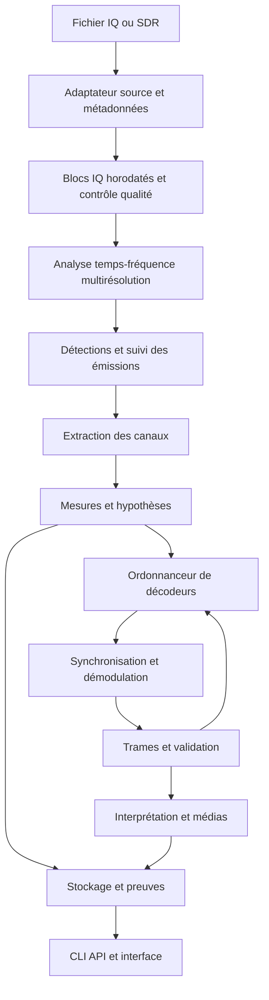

# IQScope — Spécifications techniques et plan de réalisation

Version : 0.1 — 25 octobre 2026. Statut : architecture cible proposée, exigences et critères de validation. Ce document ne décrit pas des fonctionnalités déjà réalisées sauf dans la section 2.


Complément de périmètre : [Protocoles propriétaires, documentation partielle et rétro-ingénierie](PROTOCOLES_NON_DOCUMENTES.md). Une documentation officielle publique n'est pas requise : le catalogue inclut aussi les formats reconstitués par la communauté et les protocoles inconnus étudiés à partir de captures. Les preuves et la provenance sont conservées par règle et par champ.

## Sommaire

1. Vision et périmètre
2. État réel du prototype
3. Exigences produit
4. Architecture
5. Acquisition et formats
6. Détection et suivi
7. Classification et recherche automatique
8. Synchronisation et démodulation
9. Protocoles et validation
10. Exemple de chaîne spécialisée : LoRa et LoRaWAN
11. Catalogue de décodeurs
12. Analyse des signaux inconnus
13. Interface
14. Modèles de données et API
15. Exécution et performances
16. Corpus, métriques et tests
17. Sécurité, données et dépendances
18. Intégrations et choix technologiques
19. Feuille de route
20. Backlog et définition de terminé
21. Risques et décisions ouvertes
22. Exemple de parcours et glossaire

## 1. Vision et périmètre

### 1.1 Objectif

Construire un analyseur radio automatique capable de recevoir un fichier IQ ou un flux SDR, découvrir les émissions présentes, estimer leur nature, rechercher les chaînes de décodage pertinentes, extraire les informations récupérables et présenter les résultats sans réglages DSP obligatoires.

Le parcours normal est : ouvrir une source → lancer l'analyse → sélectionner une émission → consulter ses informations et son contenu. Le traitement peut démarrer avant la sélection ; celle-ci sert à explorer et à donner une priorité de calcul.

L'utilisateur ne doit pas avoir à choisir un filtre, une décimation, une correction de fréquence, une vitesse symbole, un facteur d'étalement ou une topologie GNU Radio pour les familles prises en charge.

### 1.2 Ambition et contrat réaliste

L'ambition est de couvrir progressivement les signaux anciens et modernes : télégraphie, analogique, télémétrie, transmissions numériques, IoT, satellites et standards cellulaires documentés. Le produit ne promet pas de décoder tout signal possible.

Il faut distinguer :

- détecter de l'énergie ;
- isoler une émission ;
- reconnaître une famille probable ;
- récupérer des symboles ;
- reconstruire des bits ;
- valider une trame ;
- interpréter son protocole ;
- produire un contenu intelligible.

Ces étapes ont des taux de réussite différents. Une erreur de checksum n'annule pas une bonne estimation de fréquence. Une trame valide ne garantit pas que ses données applicatives sont lisibles. Une constellation QPSK ne permet pas, seule, d'identifier un protocole.

### 1.3 Limites fondamentales

- Le chiffrement exige les clés et le contexte appropriés ; sa suppression automatique ne fait pas partie du produit.
- Une fréquence hors bande instantanée du récepteur n'est pas observée. Scanner plusieurs bandes crée des intervalles aveugles.
- Une saturation analogique, une bande insuffisante ou un échantillonnage inadéquat peuvent perdre irréversiblement l'information.
- Plusieurs émetteurs superposés ne sont pas toujours séparables à partir d'une seule antenne.
- Une forme d'onde propriétaire ou militaire inconnue peut rester seulement caractérisée.
- Un standard futur, dont 6G, doit être ajouté à partir d'une spécification exploitable ; « 6G » ne désigne pas aujourd'hui un décodeur universel à implémenter.

## 2. État réel du prototype

Le dépôt contient actuellement un module Python monolithique, une CLI, une démonstration synthétique, quatre tests et un workflow CI.

Fonctions existantes :

- lecture SigMF simple : cf32_le, cf32_be, ci16_le, ci16_be, cu8 ;
- lecture brute complexe float32 avec fréquence d'échantillonnage fournie ;
- estimation spectrale par Welch ;
- segmentation fréquentielle par seuil global et regroupement morphologique ;
- estimation de fréquence, largeur et contraste spectral ;
- transposition, filtrage et décimation automatiques ;
- hypothèse FM par mesures d'enveloppe et fréquence instantanée ;
- sortie WAV candidate FM avec désaccentuation fixe ;
- rapport JSON et spectre CSV ;
- tests : deux émissions synthétiques, tonalité audio récupérée, bruit seul, entrée entière et métadonnées absentes.

Limites connues : lecture en mémoire, analyse des dix premières secondes par défaut, détection stationnaire, regroupement spectral fixe, absence de waterfall, absence de vrai moteur de plugins, aucun décodeur numérique, aucune réception SDR. L'audio FM est une interprétation candidate et non un contenu validé. Les signaux réels publics ne sont pas encore validés.

La CI est configurée pour Python 3.10, 3.12 et 3.13 ; sa présence ne constitue pas une preuve que toutes ses exécutions ont réussi.

## 3. Exigences produit

### 3.1 Priorités

P0 : nécessaire à la première version utile. P1 : nécessaire à une version plus générale. P2 : extension avancée.

| ID | Priorité | Exigence | Acceptation |
|---|---|---|---|
| PROD-001 | P0 | Ouvrir un SigMF sans paramètres DSP | Une capture du corpus donne des résultats avec la commande par défaut |
| PROD-002 | P0 | Découvrir automatiquement les émissions | Évaluation par événements annotés, pas uniquement par pics FFT |
| PROD-003 | P0 | Analyser sans choisir le décodeur | Le système sélectionne et compare les décodeurs compatibles |
| PROD-004 | P0 | Distinguer hypothèse et preuve | Aucune hypothèse seule ne devient un résultat validé |
| PROD-005 | P0 | Exporter les résultats | JSON versionné, trames binaires et fichiers médias associés |
| PROD-006 | P0 | Reproduire une analyse | Source, versions, configuration effective et preuves conservées |
| PROD-007 | P0 | Limiter le coût de recherche | Budgets de temps, mémoire et nombre d'hypothèses explicites |
| PROD-008 | P1 | Afficher spectre et waterfall interactifs | Sélection d'une région temps-fréquence et résultats associés |
| PROD-009 | P1 | Recevoir un SDR en direct | Pertes, fréquence réelle et horodatage exposés |
| PROD-010 | P1 | Définir les zones de balayage | Bandes, ordre et durée d'observation, sans paramètres de modulation |
| PROD-011 | P1 | Rejouer des données conservées | Une nouvelle version de décodeur peut réanalyser les mêmes IQ |
| PROD-012 | P2 | Étudier un signal inconnu | Mesures et pistes exportables sans identification forcée |

### 3.2 Comportement automatique

L'automatisation est la valeur par défaut. Le mode expert permet de contraindre une hypothèse, sans être nécessaire pour le corpus officiellement pris en charge.

Les paramètres de source impossibles à déterminer avec fiabilité ne sont pas inventés. Pour un fichier brut, demander les métadonnées indispensables ou proposer un assistant d'import avec hypothèses clairement indiquées. Il est notamment impossible de déduire une fréquence absolue fiable sans fréquence d'échantillonnage et accord du récepteur.

L'analyse retourne un résultat partiel si son budget est épuisé, avec la raison et la prochaine action possible. Elle reste annulable et sauvegarde son avancement aux frontières de tâches.

### 3.3 Hors périmètre initial

Émission radio, déchiffrement sans clés, décodeur militaire universel, réception cellulaire complète, reconstruction de vidéo arbitraire, distribution de calcul sur plusieurs machines et garanties de temps réel sur tout matériel.

## 4. Architecture cible



### 4.1 Composants

- `sources` : fichiers, SigMF, périphériques SDR, relecture.
- `stream` : blocs, horloges, files bornées, interruptions et discontinuités.
- `quality` : saturation, biais DC, déséquilibre IQ, trous et bruit.
- `detection` : PSD, STFT, segmentation et estimation du bruit.
- `tracking` : association de détections en émissions.
- `channelizer` : extraction de sous-bandes avec traçabilité.
- `features` : caractéristiques indépendantes des décodeurs.
- `inference` : hypothèses, priorités et recherche.
- `decoders` : adaptateurs vers DSP interne ou dépendances externes.
- `validation` : preuves, contradictions et classement.
- `storage` : catalogue, rapports, artefacts et index.
- `api`, `cli`, `ui` : exposition des fonctions.

### 4.2 Invariants

Les adaptateurs source ne connaissent pas les protocoles. Les décodeurs ne pilotent pas directement le matériel. L'interface ne contient pas la logique DSP. Un résultat est rattaché à un intervalle d'échantillons source. Les transformations conservent la correspondance entre leurs échantillons et la source.

Une détection peut porter plusieurs hypothèses. Une hypothèse peut produire plusieurs essais. Un essai échoué ne supprime ni la détection ni les mesures déjà acquises.

### 4.3 Refactorisation du dépôt

```text
src/iqscope/
  sources/ stream/ quality/ detection/ tracking/
  channelizer/ features/ inference/ decoders/ validation/
  storage/ api/ cli/
frontend/
tests/{unit,integration,regression}/
benchmarks/
corpus/manifests/
docs/
```

Migrer d'abord le module actuel sans changer son comportement observable, puis remplacer les algorithmes avec des régressions mesurées.

## 5. Acquisition, métadonnées et formats

### 5.1 Sources fichiers

Priorité : SigMF. Extension ultérieure : formats SDR courants et flux bruts documentés. Ne jamais interpréter un WAV comme IQ sans vérifier le nombre de canaux et la convention I/Q.

Champs obligatoires : type des échantillons, endianness, fréquence d'échantillonnage, nombre de canaux et convention d'entrelacement. Fréquence centrale obligatoire pour des résultats RF absolus ; sinon affichage en fréquences relatives.

Champs optionnels : UTC, dispositif, antenne, gain, bande analogique, position approximative si fournie, précision oscillateur, calibration et annotations. Ne pas déduire une position géographique d'une source sans l'indiquer.

### 5.2 SigMF avancé

Support à construire : captures multiples, changements de fréquence, offsets, annotations, extensions connues et validation des tailles. Chaque changement de fréquence ou de fréquence d'échantillonnage ouvre un nouveau segment de source ; ne pas concaténer silencieusement des captures incompatibles.

Vérifier la taille de chaque échantillon, le nombre de canaux, la cohérence des indices et les dépassements de taille. Refuser les chemins de données sortant de la racine d'import autorisée.

### 5.3 SDR en direct

Utiliser une abstraction matérielle, SoapySDR comme candidat principal, et des adaptateurs spécifiques si nécessaire. Un premier périphérique doit être sélectionné et testé avant de déclarer le support SDR général.

Exposer : fréquences acceptées, taux réels, gains, bande analogique, nombre de canaux, capacités de timestamp et erreurs. La valeur demandée n'est pas forcément la valeur appliquée : lire et enregistrer les réglages effectifs.

### 5.4 Balayage automatique

Entrées utilisateur : plages à explorer, périphérique, temps disponible et éventuellement une politique de gain. Aucun réglage de modulation requis.

Algorithme : définir des fenêtres RF chevauchantes, accorder, attendre la stabilisation mesurée, collecter, détecter, prioriser les revisites, enregistrer les émissions intéressantes. Éviter les bordures de bande par recouvrement configurable.

Le temps aveugle doit être mesuré. Avec un seul tuner, une analyse prolongée d'une émission interrompt ou retarde les autres fenêtres ; afficher ce compromis. Ajouter plus tard plusieurs récepteurs et une coordination de leurs couvertures.

### 5.5 Blocs et horodatage

Un bloc transporte : `source_id`, `segment_id`, `sample_start`, `sample_count`, `sample_rate`, `center_frequency`, `timestamp`, `timestamp_quality`, `discontinuity`, `dropped_samples` et données.

Les fenêtres DSP se recouvrent ; le recouvrement ne doit pas dupliquer les trames finales. Un saut d'échantillons réinitialise les synchroniseurs dépendant de la continuité. Les filtres conservent leur état entre blocs continus.

## 6. Détection et suivi des émissions

### 6.1 Prétraitement

Mesurer saturation, composante continue, amplitude, énergie et déséquilibre IQ. Conserver les données originales ; les corrections sont des transformations enregistrées et réversibles par relecture de l'original.

La suppression DC peut masquer une porteuse légitime au centre : proposer une hypothèse d'artefact et comparer les résultats avant/après, plutôt que supprimer aveuglément toute énergie centrale.

### 6.2 Analyse multirésolution

Utiliser plusieurs STFT : fenêtre courte pour les bursts, longue pour les porteuses étroites. La résolution fréquentielle vaut approximativement `Fs/N`; augmenter N améliore la séparation en fréquence au détriment de la localisation temporelle.

Générer une pyramide de waterfall pour naviguer sans recalculer la totalité. Choisir les tailles FFT en fonction du taux, de la durée et du budget, puis conserver ces choix dans le rapport.

### 6.3 Estimation du bruit

Remplacer le percentile global unique par une estimation locale robuste temps-fréquence : quantiles glissants, méthodes de type CFAR et rejet itératif des cellules occupées. Calibrer les méthodes sur des bruits blancs, colorés et des bandes fortement occupées.

Distinguer contraste spectral et SNR physique. Fournir la méthode, la bande et les hypothèses de chaque estimation ; ne pas présenter une puissance en dBm sans calibration matérielle.

### 6.4 Segmentation

Détecter des régions temps-fréquence et estimer début, fin, fréquence, largeur, énergie et incertitudes. Appliquer une hystérésis et une morphologie dont l'échelle est exprimée en secondes et hertz, pas seulement en nombre fixe de pixels.

Ne pas fusionner automatiquement toutes les raies proches : elles peuvent appartenir à des émetteurs différents. Maintenir des hypothèses de regroupement et les départager avec la cohérence temporelle et les décodeurs.

### 6.5 Suivi

Associer les observations par chevauchement temps-fréquence, trajectoire, largeur et caractéristiques. Supporter continus, bursts répétés, dérive et émissions intermittentes. Une piste d'émission est distincte d'un équipement physique : ne pas affirmer une identité matérielle sans preuve.

Cas difficiles à traiter progressivement : collision, hopping, signaux sous le bruit, impulsions, harmoniques, images du récepteur, intermodulation et émission proche de Nyquist. Les intervalles spectralement circulaires doivent être gérés sans créer deux faux signaux à la frontière FFT.

## 7. Classification et recherche automatique

### 7.1 Caractéristiques

Calculer à la demande : largeur occupée, moments d'enveloppe, PAPR, phase et fréquence instantanées, distribution des incréments, autocorrélation, périodicité, spectre cyclique, cumulants pertinents, symétries de constellation, pente des chirps, durées de bursts et périodicité de trames.

Ces caractéristiques ne sont pas toutes pertinentes pour chaque signal. Leur coût et leur domaine de validité doivent être déclarés.

### 7.2 Recherche hiérarchique

Étapes : contrôle qualité → familles analogique/numérique/chirp/multicarrier/inconnu → candidats de modulation → plages de paramètres → synchronisation → protocole → preuves.

Construire un graphe d'hypothèses, pas une cascade irréversible. Exemple : CSS → LoRa candidat → plusieurs BW/SF → préambule → en-tête → trame → CRC. Les chemins concurrents restent possibles jusqu'à une preuve discriminante.

### 7.3 Politique de calcul

Limiter le nombre d'hypothèses actives, les tailles de grilles et le temps de chaque essai. Prioriser les préambules détectés et les paramètres estimés. Utiliser une recherche grossière puis fine et un arrêt précoce lorsqu'une interprétation suffisamment validée couvre les observations.

Un résultat partiel n'autorise pas à éliminer les autres émissions superposées. Enregistrer les hypothèses non testées pour permettre une analyse approfondie ultérieure.

### 7.4 Scores et apprentissage

Séparer score heuristique, probabilité calibrée et preuve protocolaire. Une somme arbitraire de métriques n'est pas une probabilité. Les seuils et poids doivent être versionnés et évalués sur un jeu de validation séparé.

L'apprentissage automatique est optionnel au départ. S'il est ajouté, réserver une classe inconnue, documenter les domaines RF, éviter les fuites entre jeux et mesurer la robustesse aux récepteurs jamais vus. Ne pas utiliser un modèle de langage comme arbitre de validité des bits ou des trames.

## 8. Extraction, synchronisation et démodulation

### 8.1 Extraction des canaux

Transposition complexe, filtre anti-repliement et rééchantillonnage rationnel ou arbitraire contrôlé. Pour de nombreuses bandes simultanées, évaluer un banc polyphasé.

Définir bande passante utile, transition, réjection, retard de groupe et comportement aux bords. La décimation doit découler de la bande utile et des besoins du décodeur ; conserver une marge pour les estimations incertaines.

### 8.2 Synchronisation

Correction CFO grossière puis fine, dérive, estimation du taux symbole, récupération d'horloge, recherche de préambule, phase et ambiguïtés de constellation. Outils possibles selon modulation : PLL, boucle de Costas, détecteurs Gardner ou Mueller-Müller, corrélation et filtres adaptés.

Aucune boucle n'est universelle. Son domaine de convergence et les conditions d'initialisation font partie du contrat du décodeur.

### 8.3 Primitives

Prévoir des briques AM, FM, SSB, OOK/ASK, FSK/GFSK, PSK, QAM, OFDM et CSS. Une brique de démodulation ne représente pas un protocole complet.

Préférer des valeurs souples ou LLR lorsqu'un décodeur FEC les exploite. Toujours préciser ordre des bits, mapping des symboles, inversion éventuelle et échelle des valeurs souples.

### 8.4 Analogique et médias

FM : distinguer narrowband et broadcast, largeur audio, désaccentuation configurable par profil, stéréo et éventuellement RDS. AM/SSB : détection adaptée, accord fin et filtre audio. Sorties : WAV et lecteur.

Une voix intelligible ne fournit pas un checksum. Les sorties analogiques restent des interprétations accompagnées de mesures ; elles ne doivent pas être contraintes au même statut de validation qu'un paquet numérique.

Vidéo : implémentation par standard explicite, avec synchronisation lignes/trames ou dépaquetisation et codec. Pas de conversion générique « modulation vers vidéo ».

## 9. Trames, protocoles et validation

### 9.1 Chaîne numérique

Symboles → mapping → désembrouillage → désentrelacement → correction d'erreurs → synchronisation de trames → vérification → interprétation. L'ordre exact dépend du protocole et doit être déclaré, pas présumé.

Primitives possibles : Manchester et variantes, NRZ/NRZI, CRC configurables, convolutionnel/Viterbi, Reed-Solomon, BCH, LDPC et polar selon les standards effectivement ajoutés.

### 9.2 Preuves

Conserver pour chaque trame : préambule détecté, corrélation, cohérence de longueur, champs réservés, CRC présent/absent/valide/invalide, résultat FEC et contradictions.

Un CRC court peut réussir par hasard après beaucoup de tentatives. Comptabiliser l'effort de recherche et renforcer la validation par plusieurs preuves ou trames cohérentes. Ne pas prétendre corriger tous les faux positifs par un seul CRC.

### 9.3 États

Utiliser des dimensions séparées plutôt qu'un état unique ambigu :

- étape : détecté, caractérisé, synchronisé, démodulé, tramé, interprété ;
- validation : non applicable, non vérifié, cohérent, validé, contradictoire ;
- accès contenu : clair, chiffré, format inconnu, incomplet ;
- exécution : en attente, actif, terminé, budget épuisé, erreur.

Le chiffrement n'est pas un échec radio. Un paquet LoRaWAN peut être validé au niveau PHY tout en contenant une charge applicative chiffrée.

### 9.4 Valeurs numériques

Un champ interprété porte : octets source, offset, taille, signedness, endianness, formule d'échelle, unité, valeur, définition de protocole et version du parseur.

Ne pas transformer arbitrairement un payload inconnu en température ou en coordonnées. Afficher ses octets et permettre un parseur utilisateur explicite.

## 10. Exemple de chaîne spécialisée : LoRa et LoRaWAN

### 10.1 Périmètre proposé

Objectif de cette famille parmi les autres : détecter et décoder automatiquement des captures LoRa documentées, en commençant par les cas PHY conventionnels de décodeurs existants. L'intégration doit valider exactement les variantes prises en charge.

LoRa conventionnel et LR-FHSS sont des formes d'onde différentes : le support du premier n'implique pas celui du second. De même, LoRa PHY et LoRaWAN ne sont pas interchangeables.

### 10.2 Paramètres

Rechercher automatiquement fréquence, BW, SF, polarité IQ, offset temporel et CFO. Pour la première matrice : BW 125/250/500 kHz et SF7–SF12, sous réserve des capacités réelles du décodeur intégré. SF5/SF6, bandes plus étroites, modes spécialisés et variantes supplémentaires feront l'objet de lots distincts.

La durée nominale d'un symbole est `Ts = 2^SF / BW`. Cette relation guide les recherches de périodicité et de durée ; elle ne prouve pas seule une émission LoRa.

### 10.3 Pipeline PHY

1. Détecter les chirps et estimer leur largeur et pente.
2. Produire des couples BW/SF compatibles.
3. Rechercher le préambule et la synchronisation.
4. Raffiner temps, CFO et erreur d'horloge.
5. Appliquer déchirpage et FFT pour récupérer les symboles.
6. Réaliser le mapping et les transformations définies par la variante.
7. Décoder en-tête, entrelacement, whitening et FEC selon le mode.
8. Vérifier longueurs, intégrité d'en-tête et CRC payload lorsqu'il existe.
9. Exporter payload brut et preuves.

L'ordre précis des transformations sera confirmé à partir de la référence technique et de l'implémentation retenues. Utiliser des vecteurs de référence indépendants.

### 10.4 Modes explicite et implicite

En mode explicite, l'en-tête permet d'obtenir certains paramètres. En mode implicite, des paramètres de paquet doivent être connus ou explorés. Ils ne sont pas toujours identifiables de manière unique depuis un court enregistrement.

Le moteur limite la recherche et peut conclure « LoRa probable, paramètres de paquet insuffisants ». Il ne doit pas promettre le décodage automatique de tout mode implicite.

### 10.5 Intégration

Évaluer `gr-lora_sdr` et les alternatives pertinentes sur : licence, maintenance, compatibilité GNU Radio, formats, modes PHY, débits, métadonnées, installation et API d'exécution. Épingler une révision connue. Aucun engagement de compatibilité avant un test réel.

Encapsuler le décodeur dans un worker isolé ; convertir ses sorties vers le schéma IQScope. Les logs du composant ne constituent pas à eux seuls une preuve de trame valide.

### 10.6 LoRaWAN

Après récupération PHY : reconnaître la structure MAC, exposer MHDR, identifiants et compteurs selon le type de message et la version. Distinguer join, données et autres messages.

Avec clés et contexte fournis volontairement : vérifier le MIC et interpréter la charge selon la version LoRaWAN et les compteurs. Ne pas confondre clés réseau, applicatives et clés de session ; le traitement diffère entre versions. Ne pas implémenter une pseudo-vérification ignorant les compteurs ou la direction.

Sans clés : présenter le paquet, ses champs non chiffrés et son payload chiffré. Le CRC PHY, quand présent, n'est pas une validation du MIC LoRaWAN.

### 10.7 Matrice de tests LoRa

Dimensions : SF, BW, mode d'en-tête, paramètres FEC supportés, présence de CRC, polarité, longueurs, CFO, décalage d'échantillonnage, SNR, début de paquet tronqué, collisions et payloads chiffrés.

Ne pas exiger le produit cartésien complet au premier lot. Couvrir chaque dimension, les interactions à risque et les modes publiquement revendiqués. Chaque combinaison officiellement supportée doit posséder des vecteurs positifs et négatifs.

Acceptation : trouver les paramètres et récupérer des octets identiques à une référence indépendante sur les captures propres supportées ; rejeter les mauvaises hypothèses ; annoncer les échecs sous bruit ou collision sans fabriquer de contenu.

## 11. Catalogue de décodeurs à construire

| Famille | Fonction cible | Niveau de difficulté relatif | Priorité |
|---|---|---|---|
| FM analogique | Audio mono, puis stéréo et RDS séparément | Modéré | P0 |
| LoRa | Paquets PHY, puis parseur LoRaWAN | Élevé | P0 |
| Morse/CW | Détection de keying, vitesse, texte avec incertitudes | Modéré à élevé | P1 |
| AM/SSB | Audio et estimation d'accord | Modéré | P1 |
| OOK/FSK documenté | Paquets et champs d'un protocole choisi | Modéré à élevé | P1 |
| APRS/AX.25 | Audio modem, trames, CRC et champs | Élevé | P1 |
| ADS-B | Messages Mode S et contrôles spécifiques | Élevé | P1 |
| AIS | GMSK, trames et messages | Élevé | P1 |
| RTTY et modes amateurs documentés | Texte, trames selon mode | Variable | P2 |
| POCSAG/FLEX | Messages suivant mode et accès | Élevé | P2 |
| DMR/P25 et voix numérique | Trames, signalisation, codecs autorisés | Très élevé | P2 |
| Satellites documentés | Chaînes propres à chaque mission | Variable | P2 |
| Wi-Fi/Bluetooth | Acquisition et paquets selon PHY précis | Très élevé | P2 |
| LTE/5G NR | D'abord synchronisation et informations diffusées | Très élevé | P2 |
| Vidéo analogique/numérique | Un standard explicite par intégration | Très élevé | P2 |
| Propriétaire/militaire | Caractérisation et plugins documentés | Non borné | Recherche |

Cette liste est un catalogue d'intentions, pas une promesse de livraison simultanée. Les contraintes de bande, de durée de capture, de matériel et de licence doivent être documentées pour chaque famille. La réception d'une voie montante et descendante ou de plusieurs canaux peut être nécessaire pour reconstituer un contexte protocolaire.

## 12. Mode signal inconnu

Toujours produire les informations fiables disponibles : occupation temps-fréquence, trajectoire, largeur, périodicités, enveloppe, fréquence instantanée, candidats de taux symbole, vues cyclostationnaires si justifiées, constellation après synchronisation candidate et symboles ou bits candidats.

Marquer les constellations et bits comme dépendants d'une hypothèse. Des bits issus d'une mauvaise synchronisation ne sont pas du contenu extrait.

Permettre d'exporter un segment SigMF annoté et un dossier de preuves. Prévoir une API de recherche pour ajouter un protocole sans modifier le détecteur général. Une analyse de hopping peut relier statistiquement des bursts ; elle ne garantit pas la reconstruction de toute la séquence de saut.

## 13. Interface utilisateur

### 13.1 Écran source

Import d'un SigMF, résumé des métadonnées et qualité, durée analysable et bouton analyser. Pour le direct : choix du SDR et plages RF. Les paramètres DSP restent automatiques ; un volet expert expose les valeurs réellement choisies.

### 13.2 Écran exploration

Waterfall et spectre liés à la liste des émissions. Chaque ligne indique fréquence, largeur, périodes observées, famille probable, étape atteinte et état d'exécution. Éviter un pourcentage de confiance non calibré.

Sélectionner une émission ouvre ses résultats et augmente sa priorité. La découverte des autres émissions continue dans le budget autorisé.

### 13.3 Écran résultats

Onglets : résumé, contenu, trames, audio/vidéo, mesures, hypothèses et journal technique. Séparer « fréquence estimée » et « protocole confirmé ». Afficher clairement « payload chiffré », « CRC absent » ou « paramètres insuffisants » lorsqu'applicable.

Permettre export JSON, CSV, bytes, WAV, image/vidéo si produits, et segment IQ. Les champs numériques affichent unités et provenance. Les bits bruts restent accessibles.

### 13.4 Erreurs et accessibilité

Messages compréhensibles, navigation clavier, couleurs accompagnées de texte, unités explicites et fréquences lisibles. Une erreur d'un décodeur ne bloque pas l'exploration. Afficher progression et budgets ; ne pas inventer un pourcentage d'avancement lorsqu'on ne connaît pas le travail total.

## 14. Modèles de données et contrats API

### 14.1 Entités

- `Source` : provenance, format, métadonnées, empreinte et segments.
- `Analysis` : source, politique, versions, dates, état et budget.
- `Detection` : rectangle/trajectoire temps-fréquence avec incertitudes.
- `EmissionTrack` : observations associées, sans identité physique implicite.
- `Hypothesis` : famille, paramètres, score typé et alternatives.
- `DecoderAttempt` : plugin, version, entrées, budget, mesures et résultat.
- `Frame` : octets, intervalle source, validation et protocole.
- `ContentArtifact` : média ou champs interprétés et provenance.

### 14.2 Exemple de résultat cible

```json
{
  "schema_version": "1.0",
  "analysis_id": "analysis-001",
  "source_id": "source-001",
  "signal_id": "signal-003",
  "interval": {"segment_id": "segment-001", "sample_start": 120000, "sample_count": 480000},
  "rf": {"frequency_hz": 868100000, "bandwidth_hz": 125000},
  "hypothesis": {"family": "LoRa", "parameters": {"sf": 9, "bw_hz": 125000}, "score_kind": "heuristic", "score": 0.91},
  "state": {"stage": "framed", "validation": "validated", "content_access": "encrypted", "execution": "completed"},
  "validation_scope": "phy_packet",
  "evidence": [{"kind": "payload_crc", "result": "pass"}],
  "payload_artifact_id": "artifact-004",
  "decoder": {"id": "lora-adapter", "version": "example"}
}
```

Exemple de schéma, pas résultat actuel. L'absence de `mic` dans les preuves signifie qu'aucune validation MIC n'est revendiquée. Le score heuristique 0,91 n'est pas une probabilité de 91 %.

### 14.3 Contrat de plugin

Déclarer identifiant, version, licence, familles supportées, paramètres acceptés, contraintes de taux, mémoire, coût approximatif, entrées/sorties et preuves possibles.

Interface logique : `probe(context) -> hypotheses`, `decode(iq_blocks, hypothesis, budget) -> events`, `cancel(attempt_id)` et éventuellement `checkpoint()`.

Événements : estimation de paramètre, synchronisation acquise/perdue, symbole, trame, preuve, artefact, avertissement et fin. Le worker retourne des erreurs structurées et des métriques ; il ne modifie pas silencieusement la politique globale.

### 14.4 API locale

Proposition REST :

- `POST /sources` : importer une source.
- `POST /analyses` : lancer une analyse, retour 202 et identifiant.
- `GET /analyses/{id}` : état, versions et métriques.
- `POST /analyses/{id}/cancel` : annulation idempotente.
- `GET /analyses/{id}/signals` : résultats paginés.
- `GET /signals/{id}` : hypothèses et preuves.
- `GET /signals/{id}/frames` : trames paginées.
- `GET /artifacts/{id}` : contenu autorisé.
- `GET /analyses/{id}/events` : événements SSE avec identifiants et reprise.

Définir limites d'import, erreurs, idempotence de création, politique de reprise et compatibilité du schéma. Générer OpenAPI et valider les réponses contre les modèles.

## 15. Exécution, stockage et performances

### 15.1 Flux et mémoire

Passer du chargement intégral à des lecteurs par blocs et mémoire mappée. Files bornées, backpressure et compteurs de pertes sont obligatoires. Pour un SDR, définir explicitement ce qui est abandonné sous surcharge : rendu, essais secondaires ou blocs IQ ; ne pas cacher les pertes.

Ordre de dégradation : réduire fréquence d'affichage, différer essais coûteux, enregistrer les IQ si possible, puis signaler les données perdues. L'espace disque est lui aussi limité et surveillé.

### 15.2 Capacité

Le débit brut vaut `Fs × octets_par_échantillon × canaux`. Exemple : 2,4 Méch/s en cf32, soit 8 octets complexes, représente 19,2 Mo/s et environ 69 Go/h en unités décimales. À 20 Méch/s : 160 Mo/s, soit 576 Go/h. Le stockage continu doit être une décision visible.

Conserver un tampon circulaire configurable pour récupérer le début d'un burst détecté tardivement. La taille dépend du taux et de la durée de pré-déclenchement.

### 15.3 Stockage

SQLite pour catalogue local initial ; fichiers d'artefacts séparés. Écritures atomiques, hash de contenu, index par source/temps/fréquence et nettoyage transactionnel. Définir une politique de rétention pour originaux, sous-canaux et caches.

Ne pas dupliquer tous les IQ par décodeur. Réutiliser les canaux et caractéristiques avec clés de cache incluant versions et paramètres. Un changement d'algorithme invalide les dérivés concernés.

### 15.4 Objectifs mesurables

Les chiffres suivants sont des cibles à confirmer, pas des performances acquises :

- détection et aperçu d'un fichier de 10 s à 2,4 Méch/s en moins de 10 s sur une machine de référence documentée ;
- mémoire du pipeline hors import bornée par configuration, avec plafond initial visé à 2 Go ;
- première réponse de l'API de création sans attendre l'analyse complète ;
- annulation prise en compte à une frontière de bloc, avec délai cible inférieur à 2 s hors arrêt forcé d'un worker ;
- réception continue d'une source à 2,4 Méch/s sans perte imputable au logiciel sur cette même machine dans le profil validé.

Définir CPU, RAM, disque, OS, versions, nombre de canaux et charge avant d'évaluer ces objectifs. Les décodeurs ont leurs propres budgets. Un GPU n'est pas requis pour la première version.

## 16. Corpus, métriques et validation

### 16.1 Corpus

Chaque entrée possède URL, licence, auteur/provenance, hash, format, fréquence, taux, durée, modulation, paramètres connus, annotations et résultat de référence. Les grandes captures ne vont pas directement dans Git ; utiliser stockage d'artefacts ou téléchargement reproductible vérifié par hash.

Ne pas supposer qu'un fichier accessible publiquement autorise sa redistribution. Les secrets et clés ne vont pas dans les manifests publics. Ajouter une petite capture redistribuable pour les tests hors ligne quand les droits le permettent.

### 16.2 Trois niveaux

1. Synthétique déterministe : paramètres et bits exacts, défauts contrôlés.
2. Référence indépendante : capture ou vecteur produit par une autre implémentation ou un matériel connu.
3. Réel varié : récepteurs, gains, environnements et niveaux différents.

Le synthétique seul peut reproduire la même erreur que le décodeur. Les générateurs de test et les décodeurs ne doivent pas partager toutes les hypothèses non vérifiées.

### 16.3 Mesures de détection

Précision, rappel, fausses alarmes par MHz-minute, erreurs de fréquence et de largeur, erreur de début/fin et rappel par durée de burst. Fixer une règle d'association par recouvrement temps-fréquence et tolérances avant de mesurer.

Publier les résultats par famille et par plage SNR ; une moyenne globale peut cacher les émissions ratées. Une annotation incertaine ne devient pas vérité absolue.

### 16.4 Mesures de décodage

Exactitude des paramètres, taux d'acquisition, BER si bits connus, PER, octets exacts, faux décodages validés sur négatifs, nombre de tentatives et coût. Pour analogique : fidélité à une référence, récupération de tonalité et qualité d'écoute structurée lorsque pertinente.

Mesurer également la bonne abstention sur les familles absentes du catalogue. La classification doit pouvoir répondre inconnu.

### 16.5 Cibles initiales proposées

Sur un petit corpus propre et figé : rappel des émissions annotées supérieur ou égal à 95 %, précision supérieure ou égale à 95 %, octets exacts sur tous les vecteurs propres officiellement supportés. Ces valeurs ne s'appliquent pas arbitrairement à tout SNR ou toute capture.

Sur les négatifs du corpus : aucun faux paquet déclaré validé. Publier le nombre de cas et les intervalles statistiques pertinents ; zéro observé ne démontre pas un risque nul.

Pour LoRa dégradé : publier les courbes PER selon SNR, CFO et erreur d'horloge, puis définir la plage officiellement supportée à partir des résultats.

### 16.6 Tests et CI

Tests unitaires de mathématiques et de conversions ; intégration des décodeurs ; régressions sur vrais enregistrements ; invariance au découpage en blocs ; tests de fichiers tronqués, NaN, saturation et métadonnées invalides ; tests de timeout et annulation ; benchmarks séparés des tests fonctionnels.

CI rapide : installation, tests, validation de schémas, petit corpus et démonstration. CI plus lourde : compatibilité GNU Radio/LoRa et corpus étendu. Tests SDR physiques distincts, avec modèle et firmware documentés.

Les tests Linux du socle Python ne prouvent pas le fonctionnement des dépendances natives sous Windows ou macOS. Publier une matrice de plateformes réellement testées.

## 17. Sécurité, confidentialité et dépendances

Exécuter les décodeurs externes avec budgets et accès limité aux fichiers nécessaires. Les IQ, en-têtes et métadonnées sont des entrées non fiables : contrôler tailles, chemins, allocations, sorties et processus enfants. Ne jamais former une commande shell à partir d'un champ de capture.

Le service écoute par défaut sur loopback. Tout accès réseau distant exige authentification, contrôle d'origine, politique d'import et séparation des utilisateurs. Les artefacts ne sont pas accessibles via un chemin arbitraire fourni au navigateur.

Clés LoRaWAN éventuelles : stockage local protégé ou référence à un secret, aucune clé dans les logs, rapports, exports par défaut, CI ou dépôt. Les essais doivent utiliser des clés de démonstration sans valeur opérationnelle.

Les enregistrements peuvent contenir des données personnelles. Prévoir suppression des sources et dérivés, rétention explicite et aucune télémétrie contenant IQ ou payloads par défaut. L'usage et la redistribution doivent respecter les autorisations et règles applicables ; le logiciel ne déduit pas une autorisation à partir de l'absence de chiffrement.

Pour chaque dépendance : licence SPDX, révision, source, mode de liaison ou d'exécution, compatibilité de redistribution et vulnérabilités connues. Le dépôt contient une licence Apache-2.0 ; toute intégration, notamment GPL ou codecs, nécessite une vérification de compatibilité de distribution avant livraison. Un worker séparé ne résout pas automatiquement les obligations de licence.

## 18. Choix techniques proposés

| Domaine | Proposition | Justification et condition |
|---|---|---|
| Orchestration | Python | Itération DSP, écosystème, facilité d'intégration |
| Calcul initial | NumPy/SciPy | Déjà utilisés ; profiler avant réécriture |
| DSP natif | GNU Radio en worker lorsque pertinent | Réutiliser les synchroniseurs et décodeurs éprouvés |
| LoRa | Évaluation gr-lora_sdr | Valider modes, sorties, version et licence |
| SDR | SoapySDR candidat | Abstraction matérielle, validation périphérique par périphérique |
| Métadonnées | SigMF | Format documenté et annotations |
| API | FastAPI/Pydantic candidats | Schémas typés et OpenAPI |
| Catalogue | SQLite | Déploiement local simple |
| Frontend | TypeScript, framework à choisir | Waterfall WebGL si le rendu mesuré l'exige |
| Communication | REST et SSE | Commandes simples et progression reprenable |
| Packaging | Paquet Python puis image conteneur optionnelle | Socle léger ; dépendances natives isolées |

Ne pas introduire immédiatement Kafka, Kubernetes ou une architecture distribuée. Extraire les parties coûteuses en C++/Rust ou utiliser GPU uniquement après profilage et maintien de tests équivalents.

## 19. Feuille de route avec portes de validation

### Lot A — Socle fiable

Livrables : structure package, modèles versionnés, lecteur par blocs, validation SigMF, artefacts atomiques et tests de découpage. Documenter le comportement actuel et garder la CLI.

Terminé si : lecture bornée, aucune différence de résultats attribuable aux frontières de blocs sur les références, erreurs structurées et installation propre reproductible.

### Lot B — Premier corpus réel et détecteur

Livrables : manifests, captures redistribuables ou téléchargements par hash, annotations, STFT, bruit local, détection de bursts et métriques.

Terminé si : rapport précision/rappel publié sur corpus figé, baseline du prototype comparée et cas de régression conservés. La famille LoRa doit déjà être présente dans le corpus.

### Lot C — Moteur multistandard et premières intégrations

Livrables : registre de capacités, workers de décodeurs et première couverture parallèle de familles indépendantes : analogique, télégraphie, OOK/FSK, paquets amateurs, aviation/maritime et CSS/LoRa. Réutiliser les moteurs existants lorsque leur licence et leur validation le permettent. Le support LoRa ne conditionne pas les autres intégrations.

Terminé si : plusieurs familles indépendantes sont sélectionnées automatiquement sur un corpus mixte ; les sorties numériques sont vérifiées par références indépendantes ; les mauvaises hypothèses sont rejetées ; les contenus chiffrés sont identifiés ; les recherches sont bornées. Publier les capacités exactes de chaque adaptateur, sans attendre un support complet de toutes les familles.

### Lot D — Interface locale

Livrables : import, waterfall, liste de signaux, progression, sélection, trames, audio et exports. L'API permet déjà l'usage sans interface.

Terminé si : un utilisateur ouvre une capture mixte du corpus et obtient les résultats des familles supportées sans choisir de paramètres DSP.

### Lot E — Analogique et deuxième protocole numérique

Livrables : FM mieux qualifiée, Morse ou protocole FSK précisément choisi, preuve de généricité du contrat plugin.

Terminé si : le moteur choisit les décodeurs sans réglage manuel dans une capture contenant plusieurs familles supportées.

### Lot F — SDR en direct

Livrables : premier appareil testé, flux continu, réglages réels, tampon circulaire, erreurs, pertes, balayage et revisites.

Terminé si : acquisition prolongée documentée sans perte logicielle dans le profil validé, aucune trame dupliquée aux frontières, temps aveugle de balayage visible.

### Lot G — Extension et recherche

Livrables : nouveaux protocoles, cyclostationnarité, signaux inconnus, analyse de collisions et accélérations ciblées.

Chaque protocole suit le même processus : référence → corpus → décodeur → preuve → performance → documentation → annonce de support.

Ne pas donner de calendrier ferme avant les études des premiers adaptateurs et les mesures du lot B. Les durées dépendent du matériel disponible, du corpus et des dépendances. Évaluer l'effort par lot après un court prototype technique.

## 20. Backlog actionnable

| ID | Travail | Dépendances | Preuve attendue |
|---|---|---|---|
| CORE-01 | Migrer en package src | Aucune | CLI et tests inchangés |
| DATA-01 | Modèles source/résultat versionnés | CORE-01 | JSON Schema et exemples valides |
| IO-01 | Lecture SigMF par blocs | DATA-01 | Mémoire bornée et tests multi-blocs |
| IO-02 | Captures et offsets SigMF | IO-01 | Segments et erreurs testés |
| QA-01 | Mesures qualité IQ | IO-01 | Défauts injectés reconnus |
| CORP-01 | Manifests et licences | Aucune | Hash et provenance de chaque capture |
| DET-01 | STFT multirésolution | IO-01 | Bursts annotés retrouvés |
| DET-02 | Bruit local et segmentation | DET-01, CORP-01 | Comparaison chiffrée baseline |
| TRACK-01 | Association et déduplication | DET-02 | Continus et bursts sans doublons |
| DSP-01 | Channelizer traçable | IO-01 | Filtrage et mapping échantillons vérifiés |
| PLUG-01 | Contrat et worker isolé | DATA-01 | Timeout et crash sans perte d'analyse |
| LORA-01 | Audit décodeurs et licences | CORP-01 | Décision écrite avec modes testés |
| LORA-02 | Décodeur à paramètres connus | DSP-01, PLUG-01, LORA-01 | Payloads de référence exacts |
| LORA-03 | Estimation automatique BW/SF | DET-01, LORA-02 | Paramètres retrouvés sans aide |
| LORA-04 | Recherche et validation PHY | LORA-03 | CRC et preuves indépendantes |
| LORA-05 | Parseur LoRaWAN | LORA-04 | Champs interprétés et accès contenu explicite |
| ENGINE-01 | Recherche bornée multi-décodeurs | PLUG-01 | Budget et classement testés |
| STORE-01 | Catalogue et artefacts | DATA-01 | Reprise et suppression cohérentes |
| API-01 | API analyse asynchrone | ENGINE-01, STORE-01 | Création, suivi et annulation |
| UI-01 | Import et waterfall | API-01, DET-01 | Parcours complet sans DSP manuel |
| UI-02 | Paquets, preuves et médias | UI-01 | Résultats compréhensibles et exports |
| SDR-01 | Premier adaptateur matériel | IO-01 | Taux effectifs et pertes vérifiés |
| SDR-02 | Scan et revisites | SDR-01, TRACK-01 | Couverture et temps aveugle mesurés |
| CI-01 | Installation et corpus léger | CORP-01 | Reproduction dans environnement propre |
| BENCH-01 | Benchmarks détection/décodage | DET-02, LORA-04 | Rapport par condition et version |

### Définition de terminé pour un décodeur

Un décodeur n'est annoncé comme supporté que si son périmètre est écrit, sa licence vérifiée, ses paramètres et échecs documentés, ses captures de référence disponibles, ses tests positifs/négatifs passants et sa recherche automatique intégrée.

Il doit conserver les octets et preuves, fonctionner par blocs ou expliquer ses limites de buffering, respecter les budgets et produire un résultat inconnu ou incomplet sans inventer des champs.

## 21. Risques et décisions ouvertes

| Risque | Impact | Réponse |
|---|---|---|
| Objectif « tout décoder » | Travail non borné | Catalogue versionné et portée par protocole |
| Surapprentissage du synthétique | Échec sur SDR réel | Références indépendantes et récepteurs variés |
| Explosion combinatoire | Analyse trop lente | Recherche hiérarchique et budgets |
| Faux positifs après nombreuses tentatives | Contenu trompeur | Plusieurs preuves et tests négatifs massifs |
| Installation native fragile | Produit difficile à lancer | Versions épinglées et profils d'installation testés |
| Collisions et faible SNR | Paquets manquants | Courbes de performance et abstention |
| Écritures IQ volumineuses | Disque rempli | Tampon, quotas et rétention |
| Métadonnées manquantes | Fréquences ou temps faux | Import explicite et incertitudes |
| Dépendance externe abandonnée | Maintenance bloquée | Adaptateurs et corpus pérennes |

Décisions à prendre avant les lots concernés : premier SDR et OS cible ; ressources de la machine de référence ; provenance du premier corpus réel ; modes exacts de chaque première famille ; conservation des IQ par défaut ; choix du frontend ; déploiement local ou accès distant ; besoin de clés LoRaWAN ; ordre des intégrations selon couverture, maturité et corpus disponible.

Choix de départ proposés pour avancer : Linux, analyse locale, fichiers SigMF, CPU seul, première couverture multistandard par adaptateurs éprouvés, aucune clé requise et aucun service cloud obligatoire.

## 22. Parcours d'acceptation et glossaire

### Parcours LoRa cible

L'utilisateur ouvre un SigMF documenté contenant plusieurs bursts LoRa. L'application vérifie ses métadonnées, affiche les émissions, estime BW/SF et lance les essais. Les paquets valides apparaissent avec temps, fréquence, paramètres, octets et preuves. Si la charge est LoRaWAN chiffrée, l'interface l'indique. Si aucun parseur applicatif n'est connu, les octets restent bruts. Aucun choix de SF, filtre ou décimation n'est demandé.

### Parcours inconnu cible

L'utilisateur ouvre un signal absent du catalogue. L'application montre sa zone temps-fréquence, ses caractéristiques et les hypothèses testées. Aucun protocole ne satisfaisant les preuves, elle indique « signal non identifié », conserve les mesures et permet l'export d'un segment IQ pour recherche.

### Glossaire

- IQ : représentation complexe bande de base, composantes en phase et quadrature.
- Porteuse : composante ou référence fréquentielle ; une émission n'a pas toujours une raie de porteuse visible.
- CFO : écart de fréquence entre référence du signal et récepteur.
- SFO : écart de fréquence d'échantillonnage.
- STFT : transformée de Fourier sur fenêtres temporelles.
- PSD : densité spectrale de puissance.
- CSS : modulation par chirps étalés.
- SF : facteur d'étalement LoRa.
- BW : largeur de bande.
- FEC : correction d'erreurs.
- CRC : contrôle d'intégrité non cryptographique.
- MIC : contrôle d'intégrité cryptographique de message.
- PHY : couche physique radio.
- MAC : couche de contrôle d'accès et de structuration des échanges.
- Payload : charge utile, éventuellement chiffrée ou non interprétée.
- SNR : rapport signal sur bruit dans une bande et selon une méthode définies.
- BER/PER : taux d'erreur de bits/paquets, nécessitant une référence ou un protocole d'évaluation.

## Références de départ à vérifier lors de l'implémentation

- SigMF : https://sigmf.org/ et https://github.com/sigmf/SigMF
- GNU Radio : https://www.gnuradio.org/
- SoapySDR : https://github.com/pothosware/SoapySDR
- gr-lora_sdr : https://github.com/tapparelj/gr-lora_sdr
- Spécifications LoRaWAN : https://resources.lora-alliance.org/technical-specifications
- IQEngine : https://www.iqengine.org/

Ces liens orientent l'étude. Ils ne remplacent pas la sélection d'une version, l'examen des licences ni une validation indépendante des résultats.


## 23. Stratégie de couverture maximale : plateforme multistandard

Cette section précise la priorité produit : couvrir un maximum de familles indépendantes, anciennes et modernes, en intégrant plusieurs solutions spécialisées. LoRa n'est ni le centre de l'architecture ni un prérequis aux autres décodeurs. La section LoRa sert d'exemple de profondeur attendue pour chaque famille.

L'objectif est une bibliothèque de capacités réutilisables et une orchestration automatique commune. On ne réimplémente pas tous les standards avant de rendre le système utile. On évalue et encapsule les solutions existantes, puis on développe les briques manquantes.

### 23.1 Quatre niveaux de support à publier par mode

- D : détection et mesures seulement.
- R : reconnaissance étayée de la famille ou du protocole.
- T : démodulation et récupération de trames ou symboles.
- C : contenu interprété lorsque accessible : texte, valeurs, audio, image ou vidéo.

Ces niveaux sont complétés par la validation et l'accès au contenu définis en section 9. Un standard complexe peut être au niveau C pour ses messages diffusés et au niveau R pour une autre voie. « Support 5G » ou « support militaire » sans sous-mode et sans niveau est une description interdite dans le catalogue produit.

### 23.2 Inventaire des modulations et techniques physiques

| Groupe | Techniques à couvrir progressivement | Points à estimer automatiquement |
|---|---|---|
| Télégraphie | CW, OOK, keying lent ou rapide | Durée des éléments, vitesse, fréquence et espacement |
| Analogique amplitude | AM double bande, porteuse réduite/supprimée, SSB USB/LSB, ISB | Porteuse, bande latérale, accord et largeur audio |
| Analogique angle | NFM, WFM, PM et variantes documentées | Déviation, largeur, désaccentuation et sous-porteuses |
| ASK | 2-ASK, M-ASK, OOK, modulation de charge si matériel adapté | Niveaux, timing, codage ligne |
| FSK | 2/4/M-FSK, AFSK, CPFSK, GFSK, MSK, GMSK | Espacement, débit, indice, filtre et timing |
| PSK | BPSK, QPSK, OQPSK, pi/4-DQPSK, DPSK et M-PSK | Débit, mapping, ambiguïtés et mise en forme |
| QAM | Ordres courants, QAM différentielle et variantes documentées | Ordre, égalisation, mapping et phase |
| Multicarrier | OFDM, DMT, OFDMA et variantes spécifiées | FFT, préfixe cyclique, espacement, pilotes et trame |
| Chirps | CSS/LoRa et chirps linéaires ou non linéaires | Pente, largeur, durée, direction et périodicité |
| Étalement | DSSS, séquences connues, CDMA selon standard | Chip rate, codes candidats et synchronisation |
| Saut de fréquence | FHSS, hopping documenté, LR-FHSS distinct | Bursts, trajectoires, canaux et contraintes d'observation |
| Ultra-large bande | UWB impulsionnel ou autres PHY documentées | Exige matériel et taux adaptés ; hors capacité SDR étroite |
| Multiplexage | TDM, FDM, TDMA, FDMA, sous-porteuses | Frontières de slots, canaux et relations temporelles |
| Multiantenne | Diversité, MIMO selon PHY | Voies cohérentes, calibration et estimation de canal |

Une modulation générique ne fournit pas le protocole. Les paramètres d'accès, séquences et codecs doivent être intégrés séparément. La reconnaissance de MIMO ou d'UWB ne garantit pas leur acquisition avec le matériel disponible.

### 23.3 Catalogue étendu de familles et solutions candidates

Le tableau décrit des cibles et des candidats à auditer, pas des intégrations déjà fonctionnelles. Les compatibilités, licences, versions et performances doivent être vérifiées avant adoption.

| Domaine | Modes et protocoles candidats | Sorties attendues | Solutions ou références à évaluer |
|---|---|---|---|
| Radio analogique | AM, NFM, WFM, USB, LSB, CW | Audio, mesures, identification candidate | GNU Radio, liquid-dsp, csdr, moteurs SDR documentés |
| FM broadcast | Mono, stéréo, RDS/RBDS | Audio, PI/PS, texte et champs disponibles | GNU Radio, gr-rds, redsea |
| Radio numérique broadcast | DAB/DAB+, DRM et variantes documentées | Services, texte, audio si codecs disponibles | welle.io, gr-dab, Dream, bibliothèques DRM à vérifier |
| Télégraphie | Morse international, variantes documentées | Texte avec scores et éléments temporels | Décodeurs CW existants, DSP interne validé |
| Télétypes HF | RTTY/Baudot, ASCII, SITOR, AMTOR, NAVTEX | Texte et trames selon mode | fldigi, décodeurs spécialisés documentés |
| Modes amateurs texte | PSK31/63/125, Olivia, Contestia, MFSK, THOR, DominoEX, MT63 | Texte et statut de synchronisation | fldigi et bibliothèques associées, interfaces à vérifier |
| Modes faibles signaux | FT8, FT4, JT65, JT9, WSPR, MSK144, Q65 selon versions | Messages structurés et mesures | WSJT-X, JTDX ou composants documentés, licences à auditer |
| Paquets amateurs | AX.25, APRS, AFSK1200, FSK9600, KISS en sortie | Trames, positions ou champs si présents | Dire Wolf, multimon-ng, gr-ax25 et alternatives |
| Images radioamateur | SSTV, fax radio/HF, modes météo fax | Images, synchronisation et métadonnées | QSSTV, fldigi, moteurs fax documentés |
| IoT simple et capteurs | OOK/ASK/FSK de capteurs documentés, télécommandes et compteurs | Identifiants, valeurs, unités selon protocole | rtl_433, URH pour recherche, décodeurs spécifiques |
| IoT LPWAN | LoRa PHY, LoRaWAN, LR-FHSS comme lot séparé | Trames, champs MAC, données claires si clés et parseur | gr-lora_sdr, spécifications LoRa Alliance, solutions LR-FHSS à étudier |
| Comptage et automatisme | Wireless M-Bus, protocoles ISM documentés | Trames, compteurs et valeurs si accessibles | wmbusmeters avec frontal compatible, rtl_433 selon modes |
| IEEE 802.15.4 | PHY 2,4 GHz et sous-GHz sélectionnées, Zigbee/Thread au-dessus | Trames MAC et couches accessibles | gr-ieee802-15-4, outils Wireshark et dissectors |
| Autres réseaux IoT | Z-Wave, ANT/ANT+, BLE, DECT ULE selon modes | Paquets et champs accessibles | Projets spécialisés et spécifications à auditer |
| Aviation | ADS-B 1090ES, Mode S ; UAT 978 séparé | Messages, positions selon contexte, statut de validation | readsb, dump1090, dump978 et décodeurs associés |
| Données aéronautiques | ACARS VHF, VDL Mode 2, HFDL | Messages et trames | acarsdec, dumpvdl2, dumphfdl |
| Maritime | AIS, DSC, NAVTEX | Messages, identifiants, positions et texte disponibles | AIS-catcher, gr-ais, décodeurs DSC, fldigi selon mode |
| Paging | POCSAG, FLEX, autres modes documentés | Trames et texte accessible | multimon-ng et moteurs spécifiques |
| Radio mobile numérique | DMR, P25 Phase 1/2, NXDN, dPMR, D-STAR, System Fusion | Signalisation, trames, voix claire si codecs et contexte | OP25, DSD-FME, mbelib, Codec2 pour les modes correspondants |
| Réseaux professionnels | TETRA et TETRAPOL selon ressources ouvertes | D'abord synchronisation et signalisation accessible | osmo-tetra et projets spécialisés à auditer |
| Téléphonie sans fil | DECT, modes analogiques historiques documentés | Trames et audio accessible selon contexte | gr-dect2 et ressources Osmocom à vérifier |
| Wi-Fi | 802.11a/g/p puis autres PHY explicitement sélectionnées | Trames et champs accessibles | gr-ieee802-11 ; contraintes de taux importantes |
| Bluetooth | Classic BR/EDR et BLE par PHY précise | Détection, paquets et champs accessibles | gr-bluetooth, outils dédiés ; hopping et couverture à traiter |
| Cellulaire historique | GSM/GPRS/EDGE, UMTS et autres standards documentés | Synchronisation et informations système en premier | gr-gsm, Osmocom et références 3GPP |
| Cellulaire moderne | LTE, LTE-M, NB-IoT, 5G NR selon bande/numérologie | Synchronisation, canaux diffusés, métriques ; contenu selon contexte | srsRAN 4G/Project, OpenAirInterface, outils passifs spécialisés |
| Satellites amateurs | AX.25, BPSK/FSK/GMSK, CCSDS selon mission | Télémétrie et valeurs documentées | gr-satellites, SatNOGS et décodeurs mission |
| Satellites météo | APT et systèmes LRPT/HRPT/LRIT/HRIT selon disponibilité actuelle | Images, télémétrie et produits | SatDump et outils spécialisés ; vérifier satellites actifs |
| Satellites autres | Liaisons documentées scientifiques ou commerciales | Trames et données accessibles | SatDump, gr-satellites, outils mission selon droits et modes |
| Navigation GNSS | GPS, Galileo, GLONASS, BeiDou selon signaux | Acquisition, suivi, messages navigation et observables | GNSS-SDR ; matériel, horloge et SNR adaptés |
| Temps et fréquence | DCF77, MSF, WWVB, WWV et signaux documentés | Heure, bits et qualité de synchronisation | DSP et décodeurs spécialisés par émetteur |
| Vidéo analogique | PAL, NTSC, SECAM et variantes RF sélectionnées | Image, synchronisation, audio associé | GNU Radio et projets vidéo analogique à évaluer |
| Télévision numérique | DVB-T/T2, DVB-S/S2 et autres normes sélectionnées | Transport stream, services, médias non chiffrés | gr-dtv, leandvb et outils DVB ; débit et codecs à vérifier |
| Télémétrie industrielle | FSK/PSK/QAM et protocoles publics choisis | Trames, valeurs et unités documentées | Adaptateurs spécialisés et primitives du socle |
| RFID/NFC | Modes LF/HF/UHF documentés | Détection et échanges accessibles | Matériel et frontaux adaptés ; aucun support universel par SDR standard |
| Radar et impulsions | FMCW, pulsé et formes documentées | Caractéristiques de forme d'onde, périodicités et spectres | DSP interne ; distance/vitesse uniquement avec contexte et référence adaptés |
| Signaux propriétaires ou militaires | Formes connues et documentées, bursts, hopping, étalement | Caractérisation et décodage seulement si informations suffisantes | Recherche ouverte par famille, sans promesse de déchiffrement ni support global |

Les logiciels listés peuvent être des applications complètes, des bibliothèques ou des outils de recherche. Leur présence dans ce tableau ne signifie pas qu'ils possèdent une API embarquable, un mode passif complet ou la capacité de traiter directement les IQ de notre pipeline.

### 23.4 Réutilisation : quatre stratégies d'intégration

1. Bibliothèque : appel direct si API stable, licence compatible et dépendances maîtrisées.
2. Processus worker : échanges de blocs IQ/audio et résultats structurés, supervision, budgets et arrêt.
3. Flowgraph GNU Radio : génération de paramètres et supervision automatique ; le produit cache les réglages ordinaires à l'utilisateur.
4. Conversion intermédiaire : IQ vers audio, trames ou transport stream si la solution existante attend cette entrée. La conversion conserve les horodatages et preuves.

Éviter les intégrations fondées sur le seul parsing d'un affichage console fragile. Si nécessaire temporairement, épingler la version, capturer des fixtures et signaler cette limitation. Évaluer tout moteur uniquement récepteur pour l'exécuter sans fonction d'émission activée.

### 23.5 Chaînes qui partagent des briques

Le même frontal NFM peut alimenter audio, AFSK/APRS, paging ou d'autres moteurs compatibles. Une même chaîne FSK ne doit pas imposer le même framing à des protocoles différents. Plusieurs parseurs peuvent être essayés après récupération d'une trame candidate.

Les banques de préambules, désembrouilleurs, CRC et FEC sont des primitives déclaratives réutilisables, avec paramètres exacts et vecteurs de tests. Ne pas traiter tous les CRC-16 ou tous les Reed-Solomon comme identiques.

### 23.6 Ordre de livraison orienté couverture

Vague 1 : socle multistandard, analogique AM/FM/SSB, CW, rtl_433 pour les modes effectivement validés, AX.25/APRS, ADS-B, AIS et LoRa. Ces intégrations sont indépendantes ; chacune passe par son audit et ses références. Cette vague est un périmètre de travail, pas une garantie de livraison simultanée.

Vague 2 : RDS, paging, ACARS/VDL2/HFDL, modes texte HF, SSTV/fax, satellites documentés et IEEE 802.15.4. Prioriser les adaptateurs offrant une grande couverture réelle avec des preuves fiables.

Vague 3 : radio numérique et voix, DAB/DRM, Wi-Fi/Bluetooth, DVB et GNSS, chacun avec un profil matériel et un périmètre précis.

Vague 4 : standards cellulaires plus complets, séparation de collisions, multiantenne, hopping/étalement avancés, protocoles propriétaires et formes expérimentales documentées.

Les numéros de vague reflètent le coût et les dépendances probables, pas une interdiction de contribuer plus tôt à un adaptateur autonome.

### 23.7 Fiche obligatoire par solution

Chaque intégration possède une fiche : identifiant, famille, modes exacts, niveaux D/R/T/C, fréquences et bandes typiques non exclusives, taux IQ requis, paramètres automatiques, paramètres de contexte indispensables, clés éventuelles, formats de sortie, preuves, coût CPU/RAM, plateformes, licence, version, corpus, limitations et commandes de reproduction.

La fréquence d'émission est un indice de classement, jamais la seule preuve de protocole. Un signal rejoué ou transposé peut se trouver hors de sa bande habituelle.

### 23.8 Critères d'acceptation de la couverture

Créer un tableau public généré à partir du registre des plugins. Compter les modes réellement validés, pas les noms de projets intégrés ni les simples reconnaissances.

Le corpus multistandard doit inclure des captures à plusieurs émissions, des familles non supportées, du bruit, de mauvaises métadonnées et des cas où deux décodeurs donnent des sorties candidates. Mesurer le taux de mauvais choix du moteur, le rappel par famille et les faux contenus validés.

Le produit doit pouvoir montrer simultanément une sortie audio analogique, une trame LoRa, un message AIS ou ADS-B et un capteur FSK, dans les limites de la bande réellement enregistrée. Ces émissions peuvent nécessiter plusieurs sources RF : ne pas promettre de capter des bandes éloignées simultanément avec un unique tuner étroit.

### 23.9 Backlog complémentaire de couverture

| ID | Action | Résultat vérifiable |
|---|---|---|
| MULTI-01 | Construire un registre de capacités par mode | Catalogue généré, statuts D/R/T/C et versions |
| MULTI-02 | Évaluer les moteurs de la vague 1 | Audit installation, licence, entrées, sorties et corpus |
| MULTI-03 | Ajouter l'adaptateur analogique commun | AM/FM/SSB testées séparément |
| MULTI-04 | Ajouter capteurs ISM via moteur existant | Protocoles réellement testés et valeurs documentées |
| MULTI-05 | Ajouter paquet amateur et CW | AX.25 valide et texte CW avec incertitudes |
| MULTI-06 | Ajouter aviation et maritime | Références ADS-B/AIS et checks spécifiques |
| MULTI-07 | Ajouter CSS/LoRa | Paramètres automatiques et payloads de référence |
| MULTI-08 | Faire concourir les adaptateurs | Sélection automatique sur corpus hétérogène |
| MULTI-09 | Normaliser preuves et médias | Sorties comparables sans faux niveau de validation |
| MULTI-10 | Publier matrice et benchmarks | Couverture exacte visible, limites et régressions |

La mesure principale du programme devient : nombre de modes indépendants validés automatiquement, qualité par mode et coût pour les découvrir. La profondeur LoRa reste utile, mais elle ne définit plus la portée globale du projet.

## 24. Complément de couverture : familles omises et granularité des modes

### 24.1 Règle de couverture

Aucune liste finie ne contient tous les signaux existants : variantes nationales, extensions privées, générations de matériel et formes expérimentales s'ajoutent continuellement. Le catalogue est donc un registre extensible et versionné. Cette limite ne justifie pas un catalogue étroit : chaque domaine ci-dessous doit être inventorié et faire l'objet d'une décision explicite.

Une entrée doit distinguer forme d'onde, synchronisation, codage canal, framing, protocole, codec et application. Par exemple, un démodulateur OFDM n'est ni un décodeur Wi-Fi universel ni un décodeur DVB. Un parseur NMEA n'est pas un récepteur GNSS. Un codec audio n'est pas un récepteur radio.

Dans cette section, « cible » signifie à étudier, pas support disponible. Les désignations militaires renvoient uniquement aux modes documentés et aux paramètres accessibles ; aucune capacité de déchiffrement ni connaissance de variantes non publiques n'est présumée.

### 24.2 HF, modems historiques et formes d'onde normalisées

| Sous-domaine | Entrées à inventorier séparément | Sorties et limites |
|---|---|---|
| Modems HF normalisés | MIL-STD-188-110 selon révision et mode ; STANAG 4285, 4415, 4529, 4539 | Symboles, trames et données selon définition disponible ; une désignation ne couvre pas toutes ses annexes |
| Établissement automatique HF | ALE 2G MIL-STD-188-141 ; ALE 3G STANAG 4538 ; extensions documentées | Adresses, messages de liaison et paramètres accessibles ; distinguer signalisation et canal de trafic |
| Liaison HF de données | STANAG 5066 et services documentés au-dessus du modem | Réassemblage seulement après décodage du modem et acquisition du contexte |
| Télégraphie multivoie historique | FSK télétype, F7B, systèmes à diversité, Piccolo et variantes publiques | Identification puis décodage par variante avec corpus |
| Télex et ARQ | ITA2/ITA5, CCIR 476, SITOR-A/B, AMTOR, TOR documentés | Texte, répétitions, contrôle d'erreurs et états ARQ |
| Modems amateurs HF | PACTOR I ; générations suivantes selon documentation et disponibilité ; PACKET HF | Ne pas étendre le support d'une génération aux autres ; contraintes propriétaires possibles |
| Modems contemporains | VARA HF/FM, ARDOP, WINMOR et interfaces documentées | Évaluer la disponibilité d'un décodage passif : une application de modem peut nécessiter une session active |
| Transmission d'images/données | EasyPal, HamDRM et modes OFDM documentés | Objets et images après chaîne complète et vérification |
| Signaux HF de référence | CHU, RWM, BPM, JJY et autres émissions documentées | Temps, identifiants ou mesures suivant émission et disponibilité actuelle |
| Recherche HF | Familles propriétaires connues par signatures publiques | Mesures et hypothèses lorsque protocole ou code non disponible |

Les liaisons tactiques publiques dans la littérature, telles que Link 11, Link 16 ou Link 22, doivent avoir des fiches d'étude distinctes : bande et acquisition, forme d'onde documentée, contexte et accès au contenu. Leur présence au registre ne constitue pas un engagement de décodage ni une promesse qu'un SDR ordinaire puisse les observer intégralement.

### 24.3 Broadcast et télévision : détailler les standards

| Domaine | Modes à distinguer | Résultats cibles |
|---|---|---|
| FM auxiliaire | RDS/RBDS, RadioText, groupes spécifiques ; SCA et sous-porteuses documentées | Champs structurés et audio auxiliaire selon mode |
| Radio numérique | DAB, DAB+, DMB, DRM30, DRM+, HD Radio/IBOC selon accès technique et licences | Multiplex, services et médias accessibles |
| TV terrestre | DVB-T, DVB-T2, ATSC 1.0, ATSC 3.0, ISDB-T, DTMB | Synchronisation, services et flux accessibles ; profils et codecs distincts |
| TV satellite | DVB-S, DVB-S2, DVB-S2X, ISDB-S et variantes documentées | Trames de base, flux et services accessibles |
| TV câble | DVB-C/C2, ITU-T J.83 selon annexe | Analyse d'une capture issue d'un frontal câble adapté |
| TV analogique | PAL/NTSC/SECAM : modulation RF, polarité, son et variantes de canal | Image et son ; standard couleur et transmission RF sont deux couches |
| Services historiques | Télétexte, sous-titrage ligne 21, VPS/PDC et données VBI | Texte et métadonnées si les lignes sont présentes dans la capture |
| Contribution professionnelle | Modes DVB et liaisons de contribution documentées | Pas d'assimilation automatique aux émissions grand public |

Le chiffrement et le contrôle d'accès des services numériques restent des états de contenu. Le décodage du multiplex ne fournit pas automatiquement les médias protégés.

### 24.4 Aviation, maritime et réseaux terrestres spécialisés

- Aviation supplémentaire : ADS-B UAT 978 distinct du 1090ES ; VDL modes 1/3/4 selon documentation et pertinence actuelle ; SELCAL ; signalisation et voix AM aéronautique.
- Navigation aéronautique : VOR, ILS localizer/glideslope, marqueurs et DME documentés. Décoder une modulation ne constitue pas un instrument de navigation certifié ; les observables exigent calibration et géométrie adaptées.
- Surveillance : signaux d'interrogation/réponse SSR et modes publics documentés ; séparer réception des réponses, association à des interrogations et estimation de position.
- Maritime supplémentaire : ATIS, VDES et sous-composants VDE-TER/VDE-SAT/ASM suivant standards et corpus ; Inmarsat-C/EGC et autres services documentés selon accès et disponibilité.
- Services mobiles analogiques : CTCSS, DCS, tonalités 2/5 tons, DTMF, MDC-1200, FleetSync et autres signalements documentés.
- Trunking : MPT1327, LTR, EDACS et systèmes documentés ; séparer canal de contrôle, suivi des allocations, canal voix et codec. Les variantes propriétaires nécessitent leurs propres preuves.
- Rail et infrastructures : GSM-R, TETRA ferroviaire et autres systèmes publics documentés ; protocoles industriels radio spécifiques, sans supposer le contenu à partir de la seule bande.
- Alertes : SAME/EAS et autres alertes documentées transportées en audio ; messages et validation selon format.

### 24.5 Satellites, espace et télémétrie

| Domaine | Modes et couches à ajouter | Conditions |
|---|---|---|
| Standards spatiaux | CCSDS : TM, TC, AOS, transfert de paquets, synchronisation et codages selon profil | La mission choisit ses options ; identifier son profil exact |
| Modulations spatiales | PCM/PSK/PM, BPSK/QPSK/OQPSK, FSK/GMSK et autres modes mission | Traitement Doppler et horloges ; aucune famille unique « satellite » |
| Codages spatiaux | Reed-Solomon, convolutionnel, turbo, LDPC, randomisation et marqueurs selon standard | Conserver configurations et preuves propres au profil |
| Météo et observation | APT, LRPT, HRPT, LRIT/HRIT, variantes de missions et produits | Vérifier état opérationnel, fréquence et droits du corpus |
| Radiosondes | Familles RS41/RS92, DFM, M10/M20, iMet et autres modèles documentés | Télémétrie et unités selon modèle ; changements de firmware possibles |
| Balises | Cospas-Sarsat 406 MHz et variantes documentées | Identifier messages et validation, sans émission de test sur le réseau réel |
| Réseaux satellitaires | Iridium, Orbcomm, Argos, services Inmarsat et autres formes documentées | Détection et champs accessibles ; restrictions de documentation, chiffrement et licences à expliciter |
| Amateur spatial | Protocoles mission, AX.25, FX.25, IL2P et autres usages documentés | Réassemblage et télémétrie définis par mission |
| Télémétrie d'essais | IRIG 106, PCM/FM, SOQPSK-TG, ARTM CPM selon profil accessible | Modulation, structure PCM et schéma de mesure distincts |
| GNSS élargi | SBAS et signaux d'augmentation, QZSS, NavIC ; bandes et composantes par constellation | Un récepteur L1 seul ne donne pas le support de toutes les bandes |

Une capture de télémétrie sans dictionnaire de paramètres permet parfois de récupérer des trames mais pas d'attribuer des noms et unités aux mesures. Conserver alors les mots bruts et offsets.

### 24.6 IoT, domotique, industriel et courte portée

- IEEE 802.15.4 : distinguer PHY O-QPSK, BPSK et autres variantes ; 802.15.4g/SUN FSK, OFDM et O-QPSK ; Wi-SUN au-dessus des couches concernées.
- LPWAN : Sigfox montant/descendant suivant références accessibles, Weightless et autres systèmes documentés ; NB-IoT et LTE-M restent des profils cellulaires avec leurs dépendances.
- Bluetooth : BR, EDR et BLE 1M/2M/Coded séparés ; advertising, connexions, hopping et couches applicatives sont des sous-périmètres différents.
- Automatisme : EnOcean, KNX RF, Z-Wave par région/génération, IO-Link Wireless et protocoles documentés ; ne pas supposer un décodeur commun.
- Comptage : Wireless M-Bus par mode S/T/C/N et variantes ; OMS comme profil au-dessus ; autres réseaux de compteurs uniquement lorsque formats et droits sont identifiés.
- Télémétrie d'objets : TPMS, stations météo, alarmes, télécommandes, capteurs énergétiques et trackers ; chaque format reconnu possède sa fiche et ses vecteurs.
- Aéromodélisme et drones : liaisons de télémétrie documentées, Remote ID sur transports concernés, protocoles de commande ou vidéo documentés ; matériel et bande souvent différents.
- Audiovisuel courte portée : microphones sans fil analogiques et numériques, intercoms et retours audio selon systèmes documentés ; certaines solutions sont propriétaires ou chiffrées.
- RFID : LF 125/134 kHz, ISO 14443 A/B, ISO 15693/NFC, UHF EPC Gen2/ISO 18000-63 et variantes ; couplage, bande et frontaux dédiés à prévoir.

Les payloads de capteurs ne sont interprétés en valeurs qu'avec un protocole ou dictionnaire documenté. Un identifiant de fabricant n'est pas une preuve suffisante de format applicatif.

### 24.7 Cellulaire, accès large bande et liaisons de données

Distinguer au minimum GSM, GPRS, EDGE ; UMTS/WCDMA, HSPA ; CDMA2000 et variantes documentées ; LTE FDD/TDD, LTE-M, NB-IoT ; 5G NR FR1/FR2 et profils pertinents ; LTE/NR sidelink ; WiMAX/IEEE 802.16 selon disponibilité ; accès fixes propriétaires documentés.

Pour chaque système, définir des étapes séparées : détection de cellules, synchronisation, informations système diffusées, identification des ressources, décodage de canaux accessibles et reconstitution de session quand le contexte est disponible. Les bibliothèques de stations de base et terminaux ne sont pas nécessairement des décodeurs passifs prêts à l'emploi.

Le support 6G demeure un espace d'extensions expérimentales ou de futurs standards nommés et versionnés. Les termes OTFS, FBMC, UFMC, GFDM ou autres formes étudiées peuvent figurer au registre de recherche sans être présentés comme un standard 6G établi.

### 24.8 Physiques additionnelles et signaux non communicationnels

Compléter le registre avec APSK et ordres DVB ; FQPSK/SOQPSK ; CPM et paramètres de mémoire ; OOK impulsionnel ; PPM/PAM ; modulation d'indice ; formes chirp autres que LoRa ; séquences d'étalement et pilotes documentés. Les combinaisons modulation/codage créent des modes distincts à tester.

Pour radar, sondeurs ionosphériques, balises, interférences et bruits : viser d'abord détection et caractérisation. Une mesure de distance nécessite généralement timing, référence et géométrie ; une capture arbitraire de radar ne suffit pas. Le brouillage présumé reste une hypothèse de nature du signal, pas une attribution d'intention ou d'émetteur.

### 24.9 Codecs et couches de contenu : inventaire indépendant

Audio : PCM, G.711, ADPCM et profils ; codecs de voix radio tels que Codec2, AMBE/IMBE selon disponibilité, droits et intégration ; AAC/HE-AAC, MPEG audio, Opus et autres codecs des services réellement pris en charge.

Vidéo et images : MPEG-2, H.264/AVC, H.265/HEVC, AV1 et autres codecs selon multiplex ; JPEG/JPEG2000, formats scientifiques et produits satellites selon mission. Posséder FFmpeg ou un décodeur de codec n'implique pas la capacité de récupérer le flux RF correspondant.

Données : Ethernet/IP, UDP/TCP et dissectors, ASN.1, formats binaires mission, messages NMEA lorsque transportés et formats capteurs. Ces parseurs interviennent après reconstruction et identification des couches porteuses. Les compressions, fichiers fragmentés et dictionnaires propriétaires exigent leurs propres contrats.

Ajouter contrôles de bornes, décompression limitée et traitement de médias non fiables. Conserver l'original binaire même si un parseur ou lecteur échoue.

### 24.10 Solutions supplémentaires à auditer

| Usage | Candidats | Réserve |
|---|---|---|
| Reconnaissance/recherche | URH, Inspectrum, SigDigger, outils cyclostationnaires | Excellents outils d'analyse, pas nécessairement moteurs automatiques |
| Analyse professionnelle | Sigmira, Sorcerer, CODE300-32, solutions Wavecom/Krypto500 selon disponibilité | Examiner licence commerciale, API, modes réels et droits ; aucun accès présumé |
| HF et modems | fldigi, WSJT-X, ARDOP, gr-ale et projets de modems HF documentés | Maturité et possibilité de décodage passif à vérifier individuellement |
| Satellites | SatDump, gr-satellites, SatNOGS, gr-iridium pour sous-périmètres documentés | Couverture exacte et redistribution par composant |
| Radiosondes | radiosonde_auto_rx, rs1729/RS et projets apparentés à identifier précisément | Certains noms recouvrent le même écosystème ; ne pas les compter comme capacités indépendantes |
| FSK et divers | multimon-ng, rtl_433, minimodem, liquid-dsp | Distinguer moteur DSP, protocole et outil audio |
| Réseau/protocoles | Wireshark/tshark, libosmocore et bibliothèques spécifiques | Un dissector attend généralement des trames déjà récupérées |
| DVB et médias | GNU Radio gr-dtv, leandvb, bibliothèques DVB, FFmpeg | Chaînes RF et codecs ont des contraintes séparées |
| GNSS | GNSS-SDR et outils de traitement d'observables | Évaluer signaux et profils réellement implémentés |

Vérifier le projet canonique, sa licence et son activité avant d'ajouter une dépendance : un nom cité dans la littérature peut correspondre à un logiciel abandonné, indisponible ou non redistribuable. Aucun binaire opaque n'est téléchargé et exécuté automatiquement sans provenance vérifiée.

### 24.11 Fichier machine du registre cible

Créer un registre YAML/JSON validé par schéma, avec une entrée par mode et des références aux briques partagées. Champs minimaux :

```yaml
id: example.protocol.phy-mode
status: planned
family: example
layers:
  waveform: example-waveform
  framing: example-framing
  protocol: example-protocol
  content: []
capabilities:
  detection: false
  recognition: false
  frames: false
  interpreted_content: false
requirements:
  sample_rates_hz: []
  minimum_bandwidth_hz: null
  channels: 1
  coherent_channels: false
  required_context: []
  optional_keys: []
implementations: []
references: []
corpus: []
validation_metrics: {}
limitations: []
```

`planned` n'est jamais comptabilisé comme fonction disponible. Les modes inconnus d'une dépendance ne sont pas importés en bloc dans le catalogue validé. Le catalogue annoncé au public doit être généré à partir des capacités testées de la version distribuée.

### 24.12 Suivi des omissions

Ajouter un type de ticket « famille manquante » demandant nom ou exemple, source documentaire et résultat souhaité. Le triage détermine : nouvelle forme d'onde, nouveau framing, nouveau parseur, codec, variante d'un mode existant ou simple adaptation d'entrée.

Tenir une matrice domaine × couche × implémentation × corpus. Une famille sans documentation exploitable reste dans la recherche ; une famille documentée sans capture devient une tâche de corpus ; une solution mature sans adaptateur devient une tâche d'intégration. Cette séparation permet d'élargir réellement la couverture sans annoncer des centaines de faux supports.
